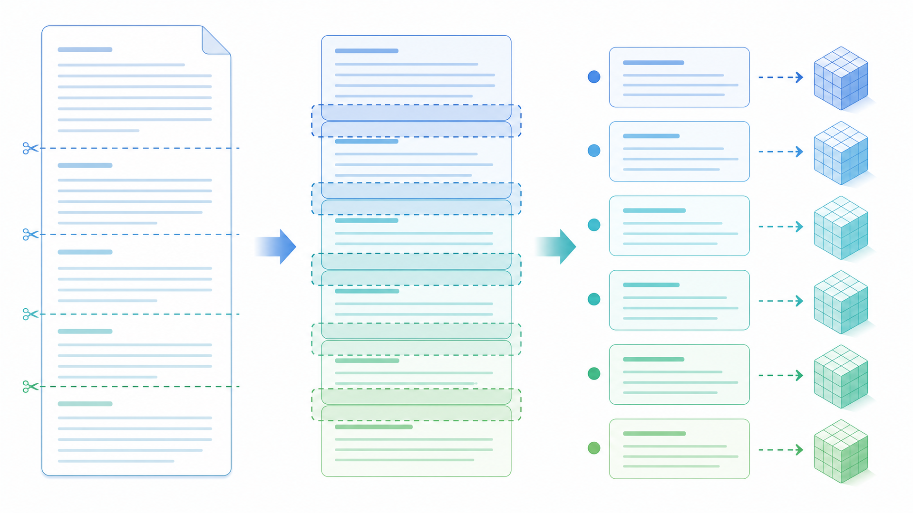

<!-- _class: lead -->

# 4회차: 문서 로딩과 청킹 전략

## RAG 품질의 절반은 청킹에서 결정된다


---



---

## 오늘의 목표

- 다양한 형식(PDF, HTML, Markdown)의 문서를 로딩한다
- 청킹이 검색 품질에 미치는 영향을 이해한다
- 고정 크기 / 재귀적 / 구조 기반 청킹을 구현하고 비교한다
- 청크 크기와 오버랩을 데이터에 맞게 튜닝한다

---

## 왜 문서를 잘라야 하나

**너무 크면:**
- 임베딩 하나에 여러 주제가 섞임 → 벡터가 "평균화"되어 검색 정확도↓
- LLM 프롬프트에 불필요한 내용 포함 → 비용↑, 답변 집중도↓

**너무 작으면:**
- 문맥이 끊김 ("그 규정에 따르면..." — 어떤 규정?)
- 답변에 필요한 정보가 여러 청크에 흩어짐

→ **"하나의 청크 = 하나의 완결된 의미 단위"**가 이상적

---

## 문서 로딩 (Document Loading)

| 형식 | 도구 | 주의점 |
|---|---|---|
| PDF | pypdf, pdfplumber, **docling** | 표·2단 레이아웃 깨짐 주의 |
| HTML | BeautifulSoup, trafilatura | 내비게이션·광고 제거 |
| Markdown | 직접 파싱 | 헤더 구조 활용 가능 (최적) |
| Word | python-docx | 스타일 정보 활용 |
| 표/Excel | pandas | 행 단위 vs 표 전체 결정 필요 |

```python
# PDF 로딩 예시
import pypdf
reader = pypdf.PdfReader("employee_handbook.pdf")
text = "\n\n".join(page.extract_text() for page in reader.pages)
```

**실무 팁**: 로딩 품질을 먼저 눈으로 확인하라. 깨진 텍스트를 청킹해봐야 소용없다.

---

## 전략 1: 고정 크기 청킹 (Fixed-size)

```python
def fixed_chunk(text: str, size: int = 500, overlap: int = 50) -> list[str]:
    chunks = []
    start = 0
    while start < len(text):
        chunks.append(text[start:start + size])
        start += size - overlap
    return chunks
```

- **장점**: 구현 간단, 어떤 문서든 동작
- **단점**: 문장/단어 중간에서 잘림

```
..."연차 휴가는 입사일 기준으로 매년 15
일 부여됩니다. 다만 1년 미만 근속자는"...   ← "15"와 "일"이 분리!
```

---

## 전략 2: 재귀적 문자 분할 (Recursive Character Splitting)

**구분자 우선순위**를 두고 큰 단위부터 시도:

```
["\n\n" (문단), "\n" (줄), ". " (문장), " " (단어), "" (문자)]
```

```python
def recursive_chunk(text: str, size: int = 500,
                    seps: list[str] = ["\n\n", "\n", ". ", " "]) -> list[str]:
    if len(text) <= size:
        return [text]
    for sep in seps:
        if sep in text:
            parts = text.split(sep)
            chunks, buf = [], ""
            for p in parts:
                if len(buf) + len(p) + len(sep) <= size:
                    buf += p + sep
                else:
                    if buf: chunks.append(buf.strip())
                    buf = p + sep
            if buf: chunks.append(buf.strip())
            # 여전히 큰 청크는 다음 구분자로 재귀 분할
            return [c for ch in chunks
                    for c in (recursive_chunk(ch, size, seps[1:]) if len(ch) > size else [ch])]
    return [text[i:i+size] for i in range(0, len(text), size)]
```

→ 가장 널리 쓰이는 **기본값(default) 전략**

---

## 전략 3: 구조 기반 청킹 (Structure-aware)

Markdown 헤더, HTML 태그 등 **문서 구조**를 경계로 사용

```python
import re

def markdown_chunk(text: str) -> list[dict]:
    """## 헤더 단위로 분할하고, 헤더 경로를 메타데이터로 보존"""
    sections = re.split(r"(?=^##\s)", text, flags=re.MULTILINE)
    chunks = []
    for sec in sections:
        if not sec.strip():
            continue
        header = sec.split("\n")[0].lstrip("# ").strip()
        chunks.append({"text": sec.strip(), "section": header})
    return chunks
```

- 헤더 경로(`인사규정 > 휴가 > 연차`)를 청크 앞에 붙이면 검색 품질↑

```
"[인사규정 > 휴가 > 연차] 연차 휴가는 입사일 기준으로..."
```

---

## 전략 4: 의미 기반 청킹 (Semantic Chunking)

- 문장별 임베딩을 구해 **인접 문장 간 유사도가 급락하는 지점**에서 분할
- 주제 전환점을 자동 감지

```python
from sentence_transformers import SentenceTransformer, util

def semantic_chunk(sentences: list[str], threshold: float = 0.5) -> list[str]:
    model = SentenceTransformer("BAAI/bge-m3")
    embs = model.encode(sentences)
    chunks, current = [], [sentences[0]]
    for i in range(1, len(sentences)):
        sim = util.cos_sim(embs[i-1], embs[i]).item()
        if sim < threshold:          # 주제가 바뀌는 지점
            chunks.append(" ".join(current))
            current = []
        current.append(sentences[i])
    chunks.append(" ".join(current))
    return chunks
```

- 비용: 인덱싱 시 임베딩 호출 증가 / 효과: 문서가 비정형일수록 큼

---

## 청크 크기와 오버랩 가이드

| 파라미터 | 권장 시작점 | 조정 방향 |
|---|---|---|
| 청크 크기 | 300~800자 (한국어) | 질문이 구체적 → 작게 / 요약형 → 크게 |
| 오버랩 | 크기의 10~20% | 문맥 단절이 관찰되면 늘리기 |
| 헤더 주입 | 항상 권장 | 섹션 경로를 청크 앞에 |

**검증 방법** (9회차에서 정식으로):
같은 질문 세트로 청킹 전략별 검색 정확도를 비교 측정

---

<!-- _class: lead -->

# 실습: 청킹 전략 비교 실험

---

## 실습: 파이프라인 구성

```python
# chunking_experiment.py
import chromadb
from chromadb.utils import embedding_functions

ef = embedding_functions.SentenceTransformerEmbeddingFunction(model_name="BAAI/bge-m3")
client = chromadb.PersistentClient(path="./chroma_db")

document = open("sample_handbook.md").read()   # 실습용 긴 문서

strategies = {
    "fixed_300":     fixed_chunk(document, size=300, overlap=30),
    "fixed_800":     fixed_chunk(document, size=800, overlap=80),
    "recursive_500": recursive_chunk(document, size=500),
    "markdown":      [c["text"] for c in markdown_chunk(document)],
}

for name, chunks in strategies.items():
    col = client.get_or_create_collection(f"exp_{name}", embedding_function=ef)
    col.add(ids=[f"{name}-{i}" for i in range(len(chunks))], documents=chunks)
    print(f"{name}: {len(chunks)}개 청크")
```

---

## 실습: 전략별 검색 결과 비교

```python
test_questions = [
    "연차는 며칠인가요?",
    "재택근무 승인 절차를 알려주세요",
    "법인카드 증빙은 언제까지 내나요?",
]

for q in test_questions:
    print(f"\n=== 질문: {q}")
    for name in strategies:
        col = client.get_collection(f"exp_{name}", embedding_function=ef)
        r = col.query(query_texts=[q], n_results=1)
        doc = r["documents"][0][0][:80].replace("\n", " ")
        dist = r["distances"][0][0]
        print(f"  [{name:>14}] ({dist:.3f}) {doc}...")
```

**관찰 포인트**:
- 어떤 전략이 질문에 정확히 답할 수 있는 청크를 1위로 올리는가?
- fixed_300은 문맥이 잘렸는가? fixed_800은 주제가 섞였는가?

---

## 과제

1. 본인 도메인 문서(10페이지 이상)로 4가지 전략 비교 실험 수행
2. 질문 10개를 만들어 전략별 top-1 정확도 표 작성
3. (심화) 헤더 경로 주입 전/후 검색 품질 비교

## 다음 시간

**5회차: 기본 RAG 파이프라인 구축** — 지금까지 배운 것을 모두 연결해 질의응답 시스템 완성
