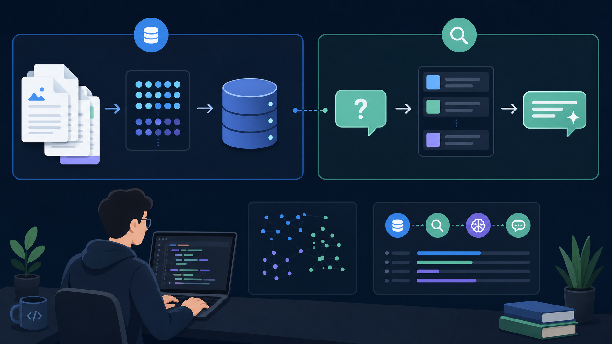

<!-- _class: lead -->

# 5회차: 기본 RAG 파이프라인 구축

## 검색 → 증강 → 생성, 전체를 연결한다


---



---

## 오늘의 목표

- 인덱싱의 파이프라인을 클래스로 구조화한다
- RAG 프롬프트를 설계한다 (근거 기반 답변, 출처 표기, 모름 처리)
- Claude API로 스트리밍 답변을 생성한다
- 완성된 CLI 질의응답 시스템을 만든다

---

## 오늘 만들 것

```
┌────────────── 인덱싱 (1회) ──────────────┐
│ 문서 → 청킹 → 임베딩 → ChromaDB 저장      │
└──────────────────────────────────────────┘

┌────────────── 질의 (실시간) ──────────────┐
│ 질문 → 임베딩 → top-k 검색                │
│      → 프롬프트 구성 → Claude → 답변+출처  │
└──────────────────────────────────────────┘
```

지난 4회차의 부품들을 **하나의 시스템**으로 조립

---

## RAG 프롬프트 설계 원칙

1. **역할과 규칙을 시스템 프롬프트에** — 문서 기반으로만 답하라
2. **문서를 명확한 구분자로 감싸기** — XML 태그 권장
3. **출처 표기 요구** — 어떤 문서에서 나온 답인지
4. **모름 처리** — 문서에 없으면 지어내지 말고 없다고 말하라
5. **질문은 마지막에** — 문서를 다 읽은 뒤 질문을 보도록

```
[시스템] 너는 사내 문서 기반 도우미다. 규칙: ...
[사용자] <documents>
           <doc id="1" source="인사규정.pdf">...</doc>
           <doc id="2" source="복지안내.pdf">...</doc>
         </documents>
         질문: 연차는 며칠인가요?
```

---

## 구현 1: RAG 클래스 뼈대

```python
# rag_pipeline.py
import anthropic
import chromadb
from chromadb.utils import embedding_functions

SYSTEM_PROMPT = """너는 사내 문서 기반 질의응답 도우미다. 규칙:
1. 반드시 <documents> 안의 내용에 근거해서만 답변한다.
2. 답변 끝에 근거 문서의 source를 [출처: ...] 형식으로 표기한다.
3. 문서에 답이 없으면 "제공된 문서에서 답을 찾을 수 없습니다"라고 답한다.
4. 추측하거나 문서 밖 지식으로 답하지 않는다."""

class SimpleRAG:
    def __init__(self, collection_name: str = "rag_docs"):
        self.llm = anthropic.Anthropic()
        ef = embedding_functions.SentenceTransformerEmbeddingFunction(
            model_name="BAAI/bge-m3")
        db = chromadb.PersistentClient(path="./chroma_db")
        self.collection = db.get_or_create_collection(
            collection_name, embedding_function=ef,
            metadata={"hnsw:space": "cosine"})
```

---

## 구현 2: 인덱싱

```python
    def index(self, docs: list[dict]):
        """docs: [{"id": ..., "text": ..., "source": ...}, ...]"""
        self.collection.add(
            ids=[d["id"] for d in docs],
            documents=[d["text"] for d in docs],
            metadatas=[{"source": d["source"]} for d in docs],
        )
        print(f"{len(docs)}개 청크 인덱싱 완료 (총 {self.collection.count()}개)")

    def retrieve(self, question: str, k: int = 4,
                 max_distance: float = 0.6) -> list[dict]:
        r = self.collection.query(query_texts=[question], n_results=k)
        return [
            {"text": doc, "source": meta["source"], "distance": dist}
            for doc, meta, dist in zip(
                r["documents"][0], r["metadatas"][0], r["distances"][0])
            if dist <= max_distance          # 관련 없는 청크는 버림
        ]
```

---

## 구현 3: 프롬프트 구성과 생성

```python
    def _build_prompt(self, question: str, chunks: list[dict]) -> str:
        docs_xml = "\n".join(
            f'<doc id="{i+1}" source="{c["source"]}">\n{c["text"]}\n</doc>'
            for i, c in enumerate(chunks))
        return f"<documents>\n{docs_xml}\n</documents>\n\n질문: {question}"

    def ask(self, question: str) -> str:
        chunks = self.retrieve(question)
        if not chunks:
            return "제공된 문서에서 답을 찾을 수 없습니다."

        with self.llm.messages.stream(
            model="claude-opus-4-8",
            max_tokens=2048,
            system=SYSTEM_PROMPT,
            messages=[{"role": "user",
                       "content": self._build_prompt(question, chunks)}],
        ) as stream:
            for text in stream.text_stream:
                print(text, end="", flush=True)   # 스트리밍 출력
            return stream.get_final_message().content[0].text
```

---

## 구현 4: CLI 인터페이스

```python
# main.py
from rag_pipeline import SimpleRAG
from chunking import recursive_chunk          # 4회차에서 만든 함수

rag = SimpleRAG()

# --- 인덱싱 (최초 1회) ---
raw = open("data/sample_handbook.md").read()
chunks = recursive_chunk(raw, size=500)
rag.index([
    {"id": f"handbook-{i}", "text": c, "source": "sample_handbook.md"}
    for i, c in enumerate(chunks)
])

# --- 대화 루프 ---
while True:
    q = input("\n질문 (종료: quit) > ").strip()
    if q == "quit":
        break
    print()
    rag.ask(q)
    print()
```

---

## 실행 예시

```
질문 > 연차는 며칠인가요?

연차 휴가는 입사일 기준으로 매년 15일이 부여됩니다.
1년 미만 근속자는 1개월 개근 시 1일씩 부여됩니다.
[출처: sample_handbook.md]

질문 > 오늘 점심 메뉴 추천해줘

제공된 문서에서 답을 찾을 수 없습니다.
```

**확인 포인트**:
- 출처가 정확히 표기되는가?
- 문서 밖 질문에 환각 없이 "모른다"고 하는가?
- 검색된 청크가 실제로 관련이 있는가? (`retrieve` 결과를 출력해서 확인)

---

## 디버깅: RAG가 틀리면 어디를 봐야 하나

```
답변이 이상함
├── retrieve() 결과를 출력해보라
│   ├── 관련 청크가 없다 → 검색 문제
│   │   ├── 청킹이 나쁨 → 4회차 (청킹 전략)
│   │   ├── 의미 매칭 실패 → 6회차 (하이브리드 검색)
│   │   └── 질문 표현 문제 → 8회차 (쿼리 변환)
│   └── 관련 청크는 있는데 순위가 낮음 → 7회차 (리랭킹)
└── 청크는 좋은데 답변이 나쁨 → 생성 문제
    ├── 프롬프트 규칙 보강
    └── 청크가 너무 많거나 김 → k, 청크 크기 조정
```

**"검색 문제인가, 생성 문제인가"를 먼저 분리하라** — RAG 디버깅의 제1원칙

---

## 과제 (중간 프로젝트)

본인 도메인 문서로 **완전한 RAG 시스템** 구축:

1. 문서 20개 이상 (또는 30페이지 이상) 인덱싱
2. 테스트 질문 15개 작성: 잘 답하는 것 / 검색 실패 / 생성 실패 분류
3. 실패 사례를 위의 디버깅 트리에 따라 원인 진단 → 다음 회차들에서 직접 개선

## 다음 시간

**6회차: 하이브리드 검색** — 의미 검색이 놓치는 것을 키워드 검색으로 잡는다
