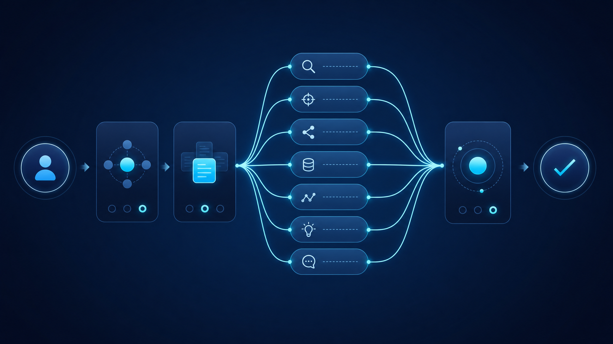

<!-- _class: lead -->

# 8회차: 쿼리 변환과 고급 RAG 패턴

## 검색 전에 질문 자체를 개선한다


---



---

## 오늘의 목표

- 쿼리 재작성(rewriting)으로 대화형 질문을 검색 가능하게 만든다
- Multi-Query, HyDE, 쿼리 분해를 구현한다
- 각 패턴의 비용-효과를 비교하고 선택 기준을 세운다
- Small-to-Big 등 컨텍스트 확장 기법을 이해한다

---

## 문제: 사용자의 질문은 검색에 최적화되어 있지 않다

| 사용자 질문 | 문제 |
|---|---|
| "그럼 그건 며칠이야?" | 대명사 — 이전 대화 없이는 검색 불가 |
| "작년에 입사한 사람도 그 혜택 받아?" | 모호한 지시어 |
| "A랑 B 중에 뭐가 더 싸?" | 두 개의 검색이 필요한 복합 질문 |
| "환불" | 정보가 너무 적음 |

→ **검색 전에 LLM으로 질문을 변환**하는 단계 추가

```
질문 → [쿼리 변환] → 검색 → 리랭킹 → 생성
```

---

## 패턴 1: 대화 맥락 기반 쿼리 재작성

멀티턴 대화에서 필수 — 대명사·생략을 해소한 독립형(standalone) 질문 생성

```python
def rewrite_query(client, history: list[dict], question: str) -> str:
    hist_text = "\n".join(f"{m['role']}: {m['content']}" for m in history[-6:])
    response = client.messages.create(
        model="claude-opus-4-8",
        max_tokens=200,
        system="대화 맥락을 반영해 마지막 질문을 검색용 독립 질문으로 재작성하라. "
               "재작성된 질문만 출력하라.",
        messages=[{"role": "user",
                   "content": f"<대화>\n{hist_text}\n</대화>\n\n"
                              f"마지막 질문: {question}"}],
    )
    return response.content[0].text.strip()

# 대화: "연차 규정 알려줘" → "..." → "그럼 이월은 돼?"
# 재작성 결과: "연차 휴가의 다음 해 이월 가능 여부"
```

---

## 패턴 2: Multi-Query — 여러 관점으로 검색

하나의 질문을 여러 표현으로 확장해 각각 검색 → 결과 합집합(RRF)

```python
def multi_query(client, question: str, n: int = 3) -> list[str]:
    response = client.messages.create(
        model="claude-opus-4-8",
        max_tokens=500,
        system=f"주어진 질문을 서로 다른 표현/관점의 검색 질문 {n}개로 변형하라. "
               "한 줄에 하나씩만 출력하라.",
        messages=[{"role": "user", "content": question}],
    )
    variants = [q.strip() for q in response.content[0].text.split("\n") if q.strip()]
    return [question] + variants   # 원본도 포함

# "재택근무 조건이 뭐야?"
# → "재택근무 신청 자격 요건"
# → "원격 근무 승인 절차"
# → "주당 재택근무 가능 일수"
```

각 질문으로 검색한 결과를 6회차의 `rrf_fuse`로 융합

---

## 패턴 3: HyDE (Hypothetical Document Embeddings)

**질문이 아니라 "가상의 정답 문서"를 임베딩해서 검색**

직관: 질문과 문서는 형태가 다르다 (짧은 의문문 vs 긴 설명문).
→ LLM이 그럴듯한 가짜 답변을 쓰게 하고, **그 답변과 비슷한 실제 문서**를 찾는다.

```python
def hyde_search(client, collection, question: str, k: int = 4):
    response = client.messages.create(
        model="claude-opus-4-8",
        max_tokens=300,
        system="질문에 대한 답변이 담긴 사내 규정 문단을 작성하라. "
               "사실 여부는 중요하지 않다. 형식과 문체가 실제 규정과 같아야 한다.",
        messages=[{"role": "user", "content": question}],
    )
    hypothetical_doc = response.content[0].text
    # 질문 대신 가상 문서로 벡터 검색!
    return collection.query(query_texts=[hypothetical_doc], n_results=k)
```

- 효과적: 질문-문서 형태 차이가 클 때 / 위험: 환각 문서가 엉뚱한 방향이면 역효과

---

## 패턴 4: 쿼리 분해 (Query Decomposition)

복합 질문을 하위 질문으로 나누어 각각 검색 후 종합

```
"PD-2000과 PD-3000 중 어느 것이 우리 예산에 맞아?"
    │
    ├── 하위질문 1: "PD-2000의 가격은?"        → 검색 → 청크 A
    ├── 하위질문 2: "PD-3000의 가격은?"        → 검색 → 청크 B
    └── 하위질문 3: "장비 구매 예산 규정은?"    → 검색 → 청크 C
                          │
                          ▼
        A + B + C를 모두 컨텍스트로 → 최종 답변 생성
```

- multi-hop 질문의 기본 해법
- 단, 하위 질문 수만큼 검색·생성 비용 증가
- **GraphRAG(11회차)가 이 문제를 구조적으로 해결** — 미리 관계를 그래프로 저장

---

## 패턴 5: Small-to-Big (검색은 작게, 컨텍스트는 크게)

검색 정밀도와 문맥 완결성의 트레이드오프를 해소:

```
인덱싱: 작은 청크(문장~문단)로 임베딩     ← 검색 정확도↑
        각 청크에 parent_id 메타데이터 저장

질의:   작은 청크로 검색 → 히트한 청크의
        "부모 문서(큰 단위)"를 프롬프트에 투입  ← 문맥 완결성↑
```

```python
# 인덱싱 시
collection.add(
    ids=[f"small-{i}"], documents=[small_chunk],
    metadatas=[{"parent_id": "section-3", "source": "..."}])

# 검색 후
parent_ids = {m["parent_id"] for m in results["metadatas"][0]}
context = "\n\n".join(parent_store[pid] for pid in parent_ids)
```

변형: **문장 윈도우** — 히트한 문장의 앞뒤 N문장을 함께 투입

---

## 어떤 패턴을 언제 쓰나

| 패턴 | 추가 비용 | 적용 조건 |
|---|---|---|
| 쿼리 재작성 | LLM 1회 (짧음) | 멀티턴 챗봇이면 **사실상 필수** |
| Multi-Query | LLM 1회 + 검색 n회 | 재현율(recall)이 낮을 때 |
| HyDE | LLM 1회 (중간) | 질문-문서 형태 차이가 클 때 |
| 쿼리 분해 | LLM 1회 + 검색·생성 n회 | 복합/비교/multi-hop 질문 |
| Small-to-Big | 저장 구조 변경 | 청크가 작아 문맥이 끊길 때 |

**원칙**: 전부 쓰지 마라. 5회차 디버깅 트리에서 진단된 **실제 실패 원인**에 맞는 것만.
모든 추가 단계는 지연시간과 비용이다.

---

## 실습: 조건부 쿼리 변환 파이프라인

```python
# adaptive_rag.py — 질문 유형에 따라 변환 전략 선택
def classify_and_transform(client, history, question) -> list[str]:
    response = client.messages.create(
        model="claude-opus-4-8",
        max_tokens=100,
        system="""질문을 분류해 한 단어로 답하라:
- simple: 단일 주제의 독립적 질문
- contextual: 이전 대화를 참조하는 질문 (대명사, 생략)
- complex: 여러 하위 질문이 필요한 복합 질문""",
        messages=[{"role": "user", "content": question}],
    )
    qtype = response.content[0].text.strip().lower()

    if qtype == "contextual":
        return [rewrite_query(client, history, question)]
    elif qtype == "complex":
        return decompose_query(client, question)
    return [question]                       # simple은 변환 없이 그대로
```

→ 불필요한 LLM 호출을 아끼는 **적응형(adaptive) RAG**의 기본 아이디어

---

## 과제

1. 중간 프로젝트에 쿼리 재작성 + Multi-Query 통합, 멀티턴 대화 시나리오 5개로 테스트
2. HyDE 적용 전/후 Hit@3 비교 (본인 데이터에서 효과가 있는가?)
3. 복합 질문 3개를 만들어 쿼리 분해 동작 확인

## 다음 시간

**9회차: RAG 평가** — "좋아진 것 같다"가 아니라 숫자로 증명하기
