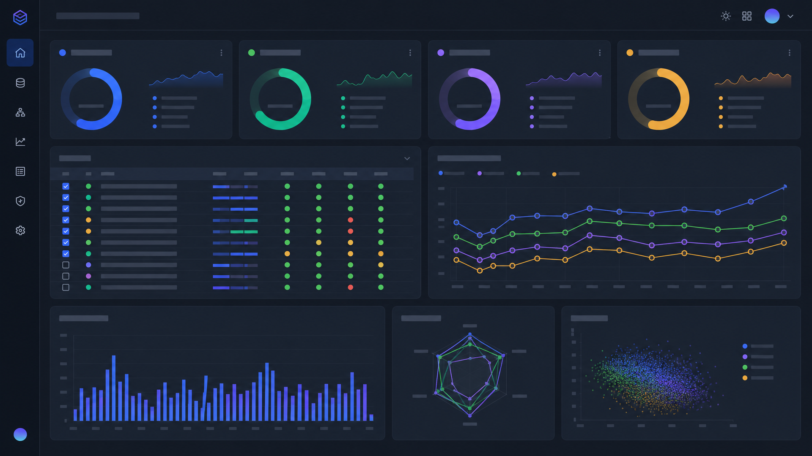

<!-- _class: lead -->

# 9회차: RAG 평가

## "좋아진 것 같다"가 아니라 숫자로 증명하기


---



---

## 오늘의 목표

- 검색 품질과 생성 품질을 분리해서 평가한다
- Hit@k, MRR, Recall@k 등 검색 지표를 구현한다
- LLM-as-Judge로 생성 품질(충실성, 관련성)을 평가한다
- RAGAS 프레임워크로 평가 파이프라인을 구축한다

---

## 왜 평가가 중요한가

- 6~8회차에서 배운 기법들은 **항상 도움이 되지 않는다**
  - HyDE가 오히려 성능을 떨어뜨리는 데이터셋도 흔함
- 개선 여부는 **본인의 데이터와 질문**에서 측정해야 앎
- 평가 없는 RAG 개선 = 계기판 없는 운전

```
변경 → 평가셋 실행 → 지표 비교 → 채택/폐기
        (자동화!)
```

**RAG 평가의 제1원칙: 검색과 생성을 분리해서 측정하라** (5회차 디버깅 트리와 동일)

---

## 평가의 두 축

```
                RAG 시스템
        ┌──────────┴──────────┐
   검색 평가                생성 평가
 (Retrieval Quality)     (Generation Quality)
        │                     │
  정답 청크를 찾았나?      찾은 청크로 잘 답했나?
        │                     │
  Hit@k, Recall@k,       Faithfulness (충실성)
  MRR, Precision@k       Answer Relevancy (관련성)
  ← 정답 라벨 필요        ← LLM-as-Judge 활용
```

---

## 검색 지표 구현

```python
# retrieval_metrics.py
def hit_at_k(retrieved_ids: list[str], answer_ids: set[str], k: int) -> float:
    """정답 청크가 top-k에 하나라도 있으면 1"""
    return float(any(rid in answer_ids for rid in retrieved_ids[:k]))

def recall_at_k(retrieved_ids: list[str], answer_ids: set[str], k: int) -> float:
    """정답 청크 중 top-k에 포함된 비율 (정답이 여러 개일 때)"""
    found = sum(1 for aid in answer_ids if aid in retrieved_ids[:k])
    return found / len(answer_ids)

def mrr(retrieved_ids: list[str], answer_ids: set[str]) -> float:
    """첫 정답의 역순위 — 1위면 1.0, 2위면 0.5, 3위면 0.33..."""
    for rank, rid in enumerate(retrieved_ids, start=1):
        if rid in answer_ids:
            return 1 / rank
    return 0.0
```

- **Hit@k**: LLM에 정답이 들어가는가 (가장 실용적)
- **MRR**: 정답이 얼마나 위에 있는가 (리랭킹 효과 측정에 적합)

---

## 평가셋 만들기

가장 어려운 부분 — 하지만 LLM으로 초안 생성 가능:

```python
# generate_evalset.py — 청크에서 질문 자동 생성
def generate_qa_from_chunk(client, chunk_id: str, chunk_text: str) -> dict:
    response = client.messages.create(
        model="claude-opus-4-8",
        max_tokens=300,
        system="주어진 문서 조각으로만 답할 수 있는 현실적인 사용자 질문 1개와 "
               "그 정답을 만들어라. JSON으로 출력: "
               '{"question": ..., "ground_truth": ...}',
        messages=[{"role": "user", "content": chunk_text}],
    )
    import json
    qa = json.loads(response.content[0].text)
    return {**qa, "answer_chunk_ids": [chunk_id]}
```

⚠️ **자동 생성 후 반드시 사람이 검수** — 비현실적 질문, 잘못된 정답 제거
⚠️ 실제 사용자 질문 로그가 쌓이면 그것이 최고의 평가셋

---

## 생성 평가: LLM-as-Judge

정답 라벨 없이도 평가 가능한 두 핵심 지표:

**Faithfulness (충실성)** — 답변이 제공된 컨텍스트에 근거하는가? (환각 탐지)

```python
def judge_faithfulness(client, context: str, answer: str) -> float:
    response = client.messages.create(
        model="claude-opus-4-8",
        max_tokens=500,
        system="""답변의 각 주장(claim)을 추출하고, 각 주장이 컨텍스트에서
확인되는지 판정하라. 마지막 줄에 '확인된 주장 수/전체 주장 수'를
'SCORE: x/y' 형식으로 출력하라.""",
        messages=[{"role": "user",
                   "content": f"<컨텍스트>\n{context}\n</컨텍스트>\n\n"
                              f"<답변>\n{answer}\n</답변>"}],
    )
    text = response.content[0].text
    x, y = text.split("SCORE:")[-1].strip().split("/")
    return int(x) / int(y)
```

**Answer Relevancy** — 답변이 질문에 실제로 대답하는가? (동문서답 탐지)

---

## RAGAS: RAG 평가 프레임워크

직접 구현한 지표들의 정제된 버전을 제공 (`pip install ragas`)

| RAGAS 지표 | 측정 대상 | 필요한 것 |
|---|---|---|
| `faithfulness` | 답변의 컨텍스트 근거성 | 질문, 답변, 컨텍스트 |
| `answer_relevancy` | 답변의 질문 관련성 | 질문, 답변 |
| `context_precision` | 검색 청크의 관련 비율 | 질문, 컨텍스트, 정답 |
| `context_recall` | 필요 정보의 검색 포함률 | 컨텍스트, 정답 |

```python
from ragas import evaluate
from ragas.metrics import faithfulness, answer_relevancy, context_recall
from datasets import Dataset

data = Dataset.from_dict({
    "question":     [...],   # 평가셋 질문들
    "answer":       [...],   # RAG 시스템의 답변들
    "contexts":     [...],   # 검색된 청크들 (list of list)
    "ground_truth": [...],   # 사람이 검수한 정답
})
result = evaluate(data, metrics=[faithfulness, answer_relevancy, context_recall])
print(result)   # {'faithfulness': 0.89, 'answer_relevancy': 0.93, ...}
```

---

## 실습: 평가 하네스 구축

```python
# eval_harness.py — 설정 변경의 효과를 한 번에 비교
import json, time

def run_eval(rag_system, eval_set: list[dict], k: int = 3) -> dict:
    metrics = {"hit@3": [], "mrr": [], "latency": []}
    for case in eval_set:
        t0 = time.time()
        chunks = rag_system.retrieve(case["question"], k=k)
        metrics["latency"].append(time.time() - t0)
        ids = [c["id"] for c in chunks]
        answers = set(case["answer_chunk_ids"])
        metrics["hit@3"].append(hit_at_k(ids, answers, k))
        metrics["mrr"].append(mrr(ids, answers))
    return {m: sum(v) / len(v) for m, v in metrics.items()}

eval_set = json.load(open("data/eval_set.json"))   # 저장소 제공 평가셋 (README 참고)
for name, system in [("기본", baseline), ("하이브리드", hybrid),
                     ("하이브리드+리랭크", full)]:
    r = run_eval(system, eval_set)
    print(f"{name:>12}: Hit@3={r['hit@3']:.0%}  MRR={r['mrr']:.3f}  "
          f"지연={r['latency']*1000:.0f}ms")
```

---

## 결과 해석 예시

```
        기본: Hit@3=60%  MRR=0.483  지연=45ms
  하이브리드: Hit@3=75%  MRR=0.590  지연=58ms
하이브리드+리랭크: Hit@3=85%  MRR=0.812  지연=290ms
```

읽는 법:

- 하이브리드: Hit +15%p — **키워드형 질문**이 개선됐는지 오답 사례 확인
- 리랭크: MRR 급상승 — 정답이 1위로 올라옴, 대신 지연 5배
- **다음 행동**: 남은 15% 실패 사례를 유형 분류 → 청킹 문제? multi-hop 문제?
  - multi-hop이 많다면 → GraphRAG(다음 회차들)의 도입 근거

---

## 평가 운영 원칙

1. **평가셋은 버전 관리** — git에 커밋, 변경 이력 추적
2. **파이프라인 변경마다 자동 실행** — CI처럼
3. **집계 점수만 보지 말고 실패 사례를 읽어라** — 개선 방향은 사례에서 나옴
4. **지연시간·비용도 함께 기록** — 품질만 보면 시스템이 무한히 무거워짐
5. LLM-as-Judge는 **같은 judge 모델로 일관되게** — 모델 바꾸면 점수 비교 불가

---

## 과제 (중간 점검)

1. 본인 프로젝트의 평가셋 20문항 구축 (자동 생성 + 검수)
2. 기본 / +하이브리드 / +리랭킹 / +쿼리변환 4단계 비교표 완성
3. 실패 사례를 유형별로 분류 — **multi-hop/전역 질문이 몇 %인지 확인** (다음 회차 예고)

## 다음 시간

**10회차: 지식 그래프 기초** — 벡터가 못 담는 "관계"를 담는 자료구조
