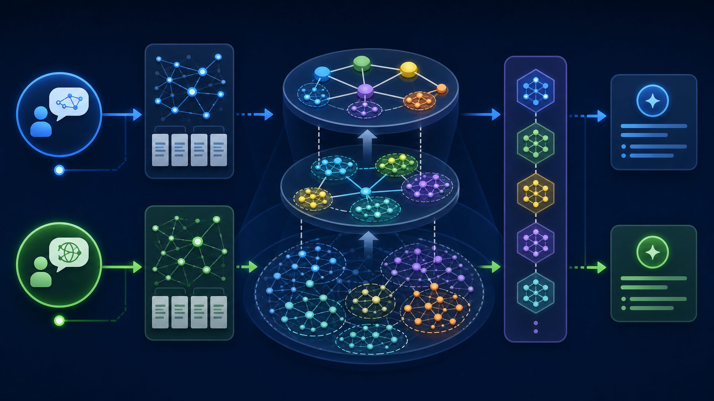

<!-- _class: lead -->

# 11회차: GraphRAG I — 개념과 아키텍처

## 전역(global) 질문을 푸는 구조적 접근


---



---

## 오늘의 목표

- 지역(local) 질문과 전역(global) 질문의 차이를 구분한다
- Microsoft GraphRAG의 인덱싱 파이프라인을 단계별로 이해한다
- 커뮤니티 탐지와 계층적 요약의 역할을 파악한다
- Local Search vs Global Search의 동작 방식을 비교한다

---

## 문제 정의: 전역 질문 (Global Question)

| 질문 유형 | 예시 | 기본 RAG |
|---|---|---|
| 지역(local) | "연차는 며칠?" | ✅ 잘함 — 답이 특정 청크에 있음 |
| 관계(multi-hop) | "김철수 상사의 결재 한도는?" | ⚠️ 그래프 탐색으로 해결 (10회차) |
| **전역(global)** | "이 문서 전체의 핵심 주제들은?" | ❌ **구조적으로 불가능** |

전역 질문이 불가능한 이유:

- "핵심 주제"와 유사한 청크는 존재하지 않음 — 답은 **모든 청크에 분산**
- top-k를 아무리 늘려도 컨텍스트 윈도우 한계
- **답을 검색하는 게 아니라, 답을 미리 만들어둬야 함**

---

## GraphRAG의 핵심 아이디어

> Microsoft Research, "From Local to Global" (2024)

**인덱싱 시점에 미리 요약 계층을 만들어 둔다:**

```
문서들
  │  ① LLM으로 개체·관계 추출
  ▼
지식 그래프
  │  ② 커뮤니티 탐지 (Leiden 알고리즘)
  ▼
커뮤니티 계층 (밀접한 개체들의 군집, 다층)
  │  ③ 커뮤니티별 LLM 요약 생성
  ▼
커뮤니티 리포트 (사전 계산된 요약문들)
```

질의 시점: 전역 질문 → **커뮤니티 리포트들**을 대상으로 map-reduce 답변

---

## 단계 ①: 개체·관계 추출 (10회차의 확장)

Microsoft GraphRAG의 추출은 우리가 만든 것보다 풍부:

- 개체: 이름 + **유형**(인물/조직/장소/개념) + **설명문**
- 관계: 주어·목적어 + **관계 설명문** + **강도 점수**
- 동일 개체가 여러 청크에서 발견되면 → 설명들을 **LLM이 통합 요약**

```json
{
  "entity": "영업본부",
  "type": "ORGANIZATION",
  "description": "영업1팀과 영업2팀을 산하에 둔 조직으로,
                  박영희 본부장이 총괄하며 PD 시리즈 판매를 책임진다."
}
```

→ 개체 자체가 하나의 "작은 문서"가 됨 (검색 대상)

---

## 단계 ②: 커뮤니티 탐지 (Community Detection)

그래프에서 **내부 연결이 조밀한 군집**을 자동 발견 — Leiden 알고리즘

```
        ┌─────── 커뮤니티 A (영업 조직) ───────┐
        │  김철수 ─ 영업1팀 ─ 영업본부 ─ 박영희  │
        └──────────────┬───────────────────────┘
                       │ (희소한 연결)
        ┌─────── 커뮤니티 B (제품/생산) ───────┐
        │  PD-2000 ─ 제조1공장 ─ 생산관리팀     │
        └──────────────────────────────────────┘
```

- **계층적**: 큰 커뮤니티 안에 하위 커뮤니티 (level 0 → 1 → 2...)
- 사람이 목차를 만들듯, 알고리즘이 **문서 전체의 주제 구조**를 발견

```python
# NetworkX + python-louvain 또는 graspologic의 leiden 사용
import networkx.algorithms.community as nx_comm
communities = nx_comm.louvain_communities(G.to_undirected())
```

---

## 단계 ③: 커뮤니티 리포트 생성

각 커뮤니티에 대해 LLM이 **구조화된 요약 리포트**를 사전 생성:

```
커뮤니티 A 리포트:
  제목: 영업본부 조직 구조
  요약: 영업본부는 박영희 본부장이 총괄하며 영업1팀(김철수 과장,
        PD-2000 담당)과 영업2팀으로 구성된다. 본부장 전결 한도는...
  주요 발견:
  - 조직 계층은 3단계 (팀 → 본부 → 대표)
  - PD 시리즈 판매가 핵심 사업
```

- 상위 레벨 커뮤니티는 **하위 리포트들을 다시 요약** (재귀적 요약)
- 인덱싱 비용이 큰 이유: 커뮤니티 수만큼 LLM 호출

---

## 질의 방식 1: Local Search

**"특정 개체에 대한 질문"** — 10회차 방식의 정교화

```
질문: "김철수는 무슨 일을 하나?"
  │ ① 질문 임베딩 ↔ 개체 설명 임베딩 매칭 → 시작 개체 발견 (김철수)
  │ ② 그 개체의 이웃 관계, 소속 커뮤니티 리포트, 원문 청크를 수집
  │ ③ 우선순위로 컨텍스트 조립 → LLM 답변
  ▼
```

10회차의 "시작 개체를 어떻게 찾나?" 문제를 **개체 임베딩 검색**으로 해결

---

## 질의 방식 2: Global Search

**"전체를 조망하는 질문"** — GraphRAG의 킬러 기능

```
질문: "이 문서들의 핵심 주제를 정리해줘"

Map 단계:  각 커뮤니티 리포트마다 LLM 병렬 호출
           "이 리포트에서 질문과 관련된 내용 + 중요도 점수"
              리포트 1 → 부분답변 A (점수 85)
              리포트 2 → 부분답변 B (점수 90)
              리포트 3 → 관련 없음  (점수 10)

Reduce 단계: 점수 상위 부분답변들을 모아 최종 종합 답변 생성
```

- 모든 청크가 아니라 **사전 요약된 리포트**를 순회 → 전역 질문 가능
- 비용: 질의당 LLM 호출 다수 → 상위 레벨(요약이 더 압축된) 리포트만 쓰면 절감

---

## GraphRAG 아키텍처 전체 조망

```
┌─────────────────── 인덱싱 (비쌈, 1회) ───────────────────┐
│ 문서 → 청킹 → [LLM] 개체·관계 추출 → 그래프 구축          │
│   → Leiden 커뮤니티 탐지 → [LLM] 커뮤니티 리포트 생성      │
│   → 개체·리포트 임베딩                                     │
└───────────────────────────────────────────────────────────┘

┌─────────────────── 질의 (유형별 라우팅) ──────────────────┐
│ 지역 질문 → Local Search  (개체 매칭 → 이웃 수집)          │
│ 전역 질문 → Global Search (리포트 map-reduce)              │
│ 단순 질문 → 기본 벡터 RAG (여전히 유효!)                   │
└───────────────────────────────────────────────────────────┘
```

---

## 비용-효과 판단

| 항목 | 기본 RAG | GraphRAG |
|---|---|---|
| 인덱싱 비용 | 임베딩만 (저렴) | 문서 전체 LLM 처리 (수십~수백 배) |
| 전역 질문 | 불가 | **가능** |
| multi-hop | 약함 | 강함 |
| 문서 업데이트 | 즉시 | 그래프 부분 재구축 필요 |

**도입 판단 기준** (9회차 평가와 연결):

- 실패 사례 중 전역/관계 질문 비율이 높은가?
- 문서가 자주 바뀌는가? (자주 바뀌면 재인덱싱 비용 부담)
- 정적이고 관계가 풍부한 코퍼스(조직 문서, 계약서, 소설, 연구 문헌)일수록 유리

---

## 미니 실습: 커뮤니티 탐지 맛보기

```python
# community_demo.py — 10회차 그래프에 커뮤니티 탐지 적용
import networkx.algorithms.community as nx_comm

# 10회차에서 만든 G 사용 (문서 수를 20개 이상으로 늘려서)
communities = nx_comm.louvain_communities(G.to_undirected(), seed=42)

for i, comm in enumerate(communities):
    print(f"\n커뮤니티 {i}: {sorted(comm)}")

# 각 커뮤니티를 LLM으로 요약해보기
for i, comm in enumerate(communities):
    facts = [(u, d["relation"], v) for u, v, d in G.edges(data=True)
             if u in comm and v in comm]
    # → facts를 프롬프트에 넣어 "이 군집을 요약하라" 호출 (10회차 graph_qa 응용)
```

→ 커뮤니티가 직관적인 주제 단위로 나뉘는지 눈으로 확인

---

## 과제

1. 10회차 그래프를 20문서 이상으로 확장 → 커뮤니티 탐지 → 각 커뮤니티 LLM 요약 생성
2. 전역 질문 3개를 만들어 (a) 기본 RAG (b) 커뮤니티 요약 기반 답변 비교
3. 본인 프로젝트에 GraphRAG가 필요한지 9회차 실패 사례 기반으로 판단문 작성

## 다음 시간

**12회차: GraphRAG 실습** — Microsoft GraphRAG 라이브러리로 실제 파이프라인 구동
